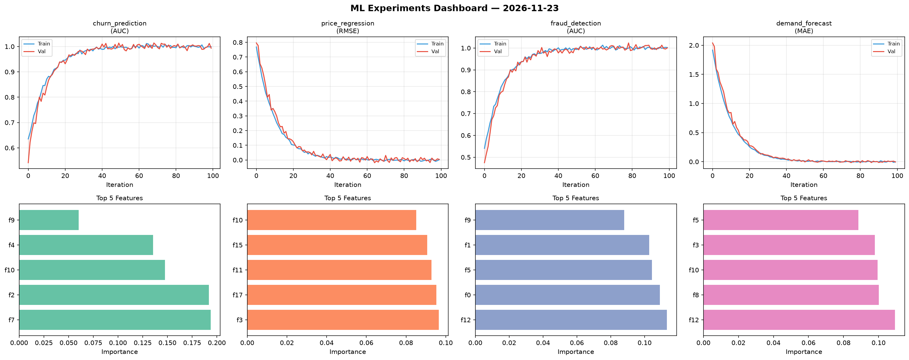
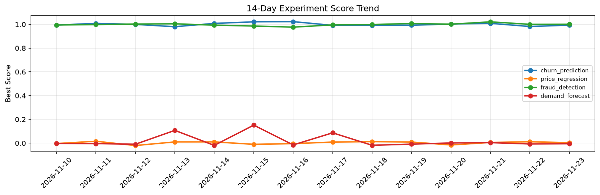

# ML Experiments Report — 2026-11-23

**Run ID:** `c44b06bbe4` | **Experiments:** 4 | **Trials:** 20

## Delta vs Yesterday

| Experiment | Today | Yesterday | Change |
|-----------|-------|-----------|--------|
| churn_prediction | 0.9934 | 0.982 | 📈 1.2% |
| price_regression | 0.0039 | 0.0116 | 📉 -66.4% |
| fraud_detection | 1.0007 | 1.0001 | 📈 0.1% |
| demand_forecast | -0.0052 | -0.0069 | 📈 24.6% |

## churn_prediction (AUC)

**Best Score:** 0.9934 (Trial 1)

| Trial | Score | Overfit Gap | Time | LR | Trees | Leaves |
|-------|-------|-------------|------|-----|-------|--------|
| 1 ⭐ | 0.9934 | 0.0057 | 9.43s | 0.2 | 100 | 63 |
| 2 | 0.9652 | 0.0005 | 241.53s | 0.05 | 1000 | 15 |
| 3 | 0.9707 | 0.0019 | 186.77s | 0.05 | 1000 | 63 |

## price_regression (RMSE)

**Best Score:** 0.0039 (Trial 1)

| Trial | Score | Overfit Gap | Time | LR | Trees | Leaves |
|-------|-------|-------------|------|-----|-------|--------|
| 1 ⭐ | 0.0039 | 0.0017 | 68.28s | 0.2 | 500 | 31 |
| 2 | 0.4147 | 0.0394 | 40.25s | 0.01 | 200 | 127 |
| 3 | 0.1727 | 0.0304 | 25.04s | 0.05 | 100 | 127 |
| 4 | 0.0162 | 0.0103 | 17.72s | 0.1 | 100 | 31 |
| 5 | 0.994 | 0.045 | 124.38s | 0.01 | 500 | 127 |

## fraud_detection (AUC)

**Best Score:** 1.0007 (Trial 6)

| Trial | Score | Overfit Gap | Time | LR | Trees | Leaves |
|-------|-------|-------------|------|-----|-------|--------|
| 1 | 1.0002 | 0.0071 | 63.09s | 0.1 | 500 | 127 |
| 2 | 0.7895 | 0.0278 | 22.95s | 0.01 | 100 | 63 |
| 3 | 0.9543 | 0.0041 | 11.7s | 0.05 | 200 | 63 |
| 4 | 0.7016 | 0.0368 | 93.72s | 0.01 | 500 | 63 |
| 5 | 0.9986 | 0.0041 | 145.82s | 0.2 | 1000 | 15 |
| 6 ⭐ | 1.0007 | 0.0016 | 24.84s | 0.2 | 100 | 127 |

## demand_forecast (MAE)

**Best Score:** -0.0052 (Trial 3)

| Trial | Score | Overfit Gap | Time | LR | Trees | Leaves |
|-------|-------|-------------|------|-----|-------|--------|
| 1 | 0.134 | 0.0086 | 47.27s | 0.05 | 200 | 15 |
| 2 | 0.1545 | 0.0059 | 183.18s | 0.05 | 1000 | 127 |
| 3 ⭐ | -0.0052 | 0.0036 | 18.44s | 0.2 | 500 | 31 |
| 4 | 0.1282 | 0.0023 | 4.2s | 0.05 | 500 | 127 |
| 5 | 0.0078 | 0.0111 | 12.61s | 0.2 | 200 | 15 |
| 6 | 0.0005 | 0.0056 | 73.11s | 0.1 | 500 | 31 |
