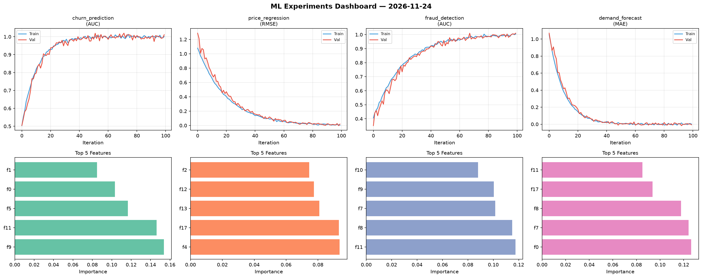

# ML Experiments Report — 2026-11-24

**Run ID:** `5955238932` | **Experiments:** 4 | **Trials:** 17

## Delta vs Yesterday

| Experiment | Today | Yesterday | Change |
|-----------|-------|-----------|--------|
| churn_prediction | 1.0111 | 0.9934 | 📈 1.8% |
| price_regression | 0.0195 | 0.0039 | 📈 400.0% |
| fraud_detection | 1.0103 | 1.0007 | 📈 1.0% |
| demand_forecast | -0.0069 | -0.0052 | 📉 -32.7% |

## churn_prediction (AUC)

**Best Score:** 1.0111 (Trial 2)

| Trial | Score | Overfit Gap | Time | LR | Trees | Leaves |
|-------|-------|-------------|------|-----|-------|--------|
| 1 | 0.9607 | 0.0173 | 24.08s | 0.05 | 200 | 15 |
| 2 ⭐ | 1.0111 | 0.0106 | 57.81s | 0.2 | 200 | 15 |
| 3 | 1.0084 | 0.0086 | 45.71s | 0.1 | 200 | 127 |

## price_regression (RMSE)

**Best Score:** 0.0195 (Trial 2)

| Trial | Score | Overfit Gap | Time | LR | Trees | Leaves |
|-------|-------|-------------|------|-----|-------|--------|
| 1 | 0.1255 | 0.0274 | 288.11s | 0.05 | 1000 | 63 |
| 2 ⭐ | 0.0195 | 0.0167 | 30.53s | 0.1 | 1000 | 31 |
| 3 | 1.0314 | 0.1106 | 299.0s | 0.01 | 1000 | 63 |
| 4 | 0.076 | 0.0028 | 226.85s | 0.05 | 1000 | 31 |
| 5 | 0.7942 | 0.1077 | 25.82s | 0.01 | 200 | 63 |

## fraud_detection (AUC)

**Best Score:** 1.0103 (Trial 1)

| Trial | Score | Overfit Gap | Time | LR | Trees | Leaves |
|-------|-------|-------------|------|-----|-------|--------|
| 1 ⭐ | 1.0103 | 0.0064 | 117.17s | 0.1 | 1000 | 15 |
| 2 | 0.5836 | 0.0656 | 8.2s | 0.01 | 100 | 127 |
| 3 | 0.998 | 0.0032 | 21.61s | 0.1 | 100 | 31 |
| 4 | 0.9605 | 0.0146 | 92.52s | 0.05 | 1000 | 63 |

## demand_forecast (MAE)

**Best Score:** -0.0069 (Trial 3)

| Trial | Score | Overfit Gap | Time | LR | Trees | Leaves |
|-------|-------|-------------|------|-----|-------|--------|
| 1 | 0.0167 | 0.0095 | 124.64s | 0.1 | 500 | 63 |
| 2 | 0.0128 | 0.007 | 29.16s | 0.1 | 500 | 31 |
| 3 ⭐ | -0.0069 | 0.0086 | 257.47s | 0.2 | 1000 | 127 |
| 4 | 0.0186 | 0.0056 | 29.37s | 0.1 | 200 | 31 |
| 5 | 0.0047 | 0.0075 | 57.01s | 0.1 | 200 | 15 |
