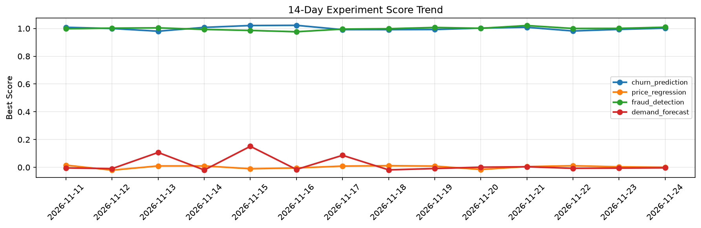

# ML Experiments Report — 2026-11-24

**Run ID:** `51389f993c` | **Experiments:** 4 | **Trials:** 20

## Delta vs Yesterday

| Experiment | Today | Yesterday | Change |
|-----------|-------|-----------|--------|
| churn_prediction | 1.0023 | 0.9934 | 📈 0.9% |
| price_regression | 0.0009 | 0.0039 | 📉 -76.9% |
| fraud_detection | 1.0091 | 1.0007 | 📈 0.8% |
| demand_forecast | -0.0035 | -0.0052 | 📈 32.7% |

## churn_prediction (AUC)

**Best Score:** 1.0023 (Trial 2)

| Trial | Score | Overfit Gap | Time | LR | Trees | Leaves |
|-------|-------|-------------|------|-----|-------|--------|
| 1 | 0.6872 | 0.0516 | 16.05s | 0.01 | 100 | 63 |
| 2 ⭐ | 1.0023 | 0.006 | 243.18s | 0.2 | 1000 | 127 |
| 3 | 1.0019 | 0.0115 | 8.09s | 0.1 | 200 | 15 |
| 4 | 0.9699 | 0.0055 | 24.03s | 0.05 | 200 | 15 |
| 5 | 0.7912 | 0.003 | 1.27s | 0.01 | 100 | 127 |

## price_regression (RMSE)

**Best Score:** 0.0009 (Trial 2)

| Trial | Score | Overfit Gap | Time | LR | Trees | Leaves |
|-------|-------|-------------|------|-----|-------|--------|
| 1 | 0.0058 | 0.0113 | 176.26s | 0.1 | 1000 | 31 |
| 2 ⭐ | 0.0009 | 0.0036 | 1.38s | 0.1 | 200 | 31 |
| 3 | 0.5847 | 0.0612 | 12.04s | 0.01 | 100 | 15 |
| 4 | 0.0128 | 0.0066 | 44.1s | 0.1 | 200 | 127 |
| 5 | 0.0461 | 0.0096 | 22.11s | 0.05 | 200 | 63 |

## fraud_detection (AUC)

**Best Score:** 1.0091 (Trial 2)

| Trial | Score | Overfit Gap | Time | LR | Trees | Leaves |
|-------|-------|-------------|------|-----|-------|--------|
| 1 | 0.9841 | 0.0112 | 111.43s | 0.1 | 500 | 31 |
| 2 ⭐ | 1.0091 | 0.0071 | 88.35s | 0.2 | 500 | 15 |
| 3 | 1.0026 | 0.0067 | 2.74s | 0.1 | 500 | 15 |
| 4 | 1.0005 | 0.0037 | 17.57s | 0.1 | 100 | 15 |

## demand_forecast (MAE)

**Best Score:** -0.0035 (Trial 2)

| Trial | Score | Overfit Gap | Time | LR | Trees | Leaves |
|-------|-------|-------------|------|-----|-------|--------|
| 1 | 0.1427 | 0.0031 | 104.6s | 0.05 | 1000 | 15 |
| 2 ⭐ | -0.0035 | 0.0204 | 18.06s | 0.1 | 1000 | 15 |
| 3 | 0.0111 | 0.0102 | 23.57s | 0.1 | 1000 | 63 |
| 4 | -0.0033 | 0.0027 | 28.07s | 0.2 | 200 | 31 |
| 5 | 1.0961 | 0.1356 | 23.98s | 0.01 | 100 | 63 |
| 6 | -0.0008 | 0.0038 | 24.84s | 0.2 | 200 | 127 |
