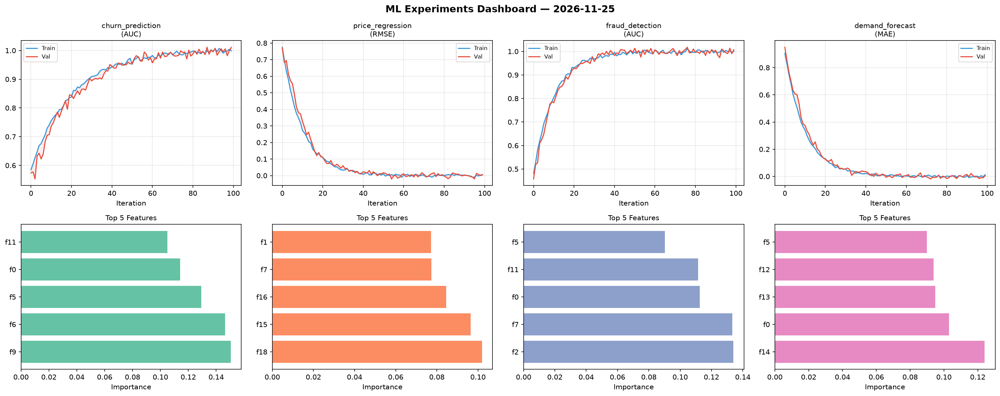
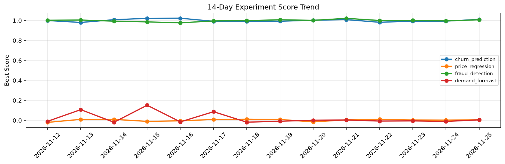

# ML Experiments Report — 2026-11-25

**Run ID:** `991aad9d12` | **Experiments:** 4 | **Trials:** 20

## Delta vs Yesterday

| Experiment | Today | Yesterday | Change |
|-----------|-------|-----------|--------|
| churn_prediction | 1.0107 | 0.9938 | 📈 1.7% |
| price_regression | 0.0061 | 0.0024 | 📈 154.2% |
| fraud_detection | 1.0073 | 0.9957 | 📈 1.2% |
| demand_forecast | 0.0054 | -0.0104 | 📈 151.9% |

## churn_prediction (AUC)

**Best Score:** 1.0107 (Trial 3)

| Trial | Score | Overfit Gap | Time | LR | Trees | Leaves |
|-------|-------|-------------|------|-----|-------|--------|
| 1 | 0.7745 | 0.0039 | 45.69s | 0.01 | 500 | 127 |
| 2 | 0.9907 | 0.0034 | 147.98s | 0.2 | 1000 | 63 |
| 3 ⭐ | 1.0107 | 0.0119 | 169.88s | 0.1 | 1000 | 15 |
| 4 | 0.9664 | 0.004 | 43.91s | 0.05 | 200 | 63 |

## price_regression (RMSE)

**Best Score:** 0.0061 (Trial 4)

| Trial | Score | Overfit Gap | Time | LR | Trees | Leaves |
|-------|-------|-------------|------|-----|-------|--------|
| 1 | 0.4382 | 0.0531 | 7.36s | 0.01 | 100 | 15 |
| 2 | 0.1182 | 0.0208 | 137.84s | 0.05 | 500 | 15 |
| 3 | 0.0064 | 0.001 | 195.28s | 0.1 | 1000 | 63 |
| 4 ⭐ | 0.0061 | 0.0016 | 24.71s | 0.2 | 500 | 127 |
| 5 | 0.0196 | 0.0034 | 152.87s | 0.1 | 1000 | 63 |
| 6 | 0.3587 | 0.0191 | 17.41s | 0.01 | 100 | 127 |

## fraud_detection (AUC)

**Best Score:** 1.0073 (Trial 3)

| Trial | Score | Overfit Gap | Time | LR | Trees | Leaves |
|-------|-------|-------------|------|-----|-------|--------|
| 1 | 1.0061 | 0.0117 | 29.51s | 0.1 | 500 | 127 |
| 2 | 0.987 | 0.008 | 16.81s | 0.1 | 100 | 127 |
| 3 ⭐ | 1.0073 | 0.0064 | 14.18s | 0.2 | 100 | 63 |
| 4 | 0.985 | 0.0118 | 46.07s | 0.1 | 200 | 31 |
| 5 | 0.9921 | 0.0112 | 10.45s | 0.2 | 100 | 127 |
| 6 | 0.759 | 0.009 | 22.8s | 0.01 | 100 | 127 |

## demand_forecast (MAE)

**Best Score:** 0.0054 (Trial 1)

| Trial | Score | Overfit Gap | Time | LR | Trees | Leaves |
|-------|-------|-------------|------|-----|-------|--------|
| 1 ⭐ | 0.0054 | 0.007 | 31.63s | 0.2 | 500 | 31 |
| 2 | 1.0367 | 0.0285 | 236.16s | 0.01 | 1000 | 31 |
| 3 | 1.2397 | 0.1662 | 54.42s | 0.01 | 500 | 127 |
| 4 | 0.1631 | 0.0204 | 28.62s | 0.05 | 200 | 31 |
