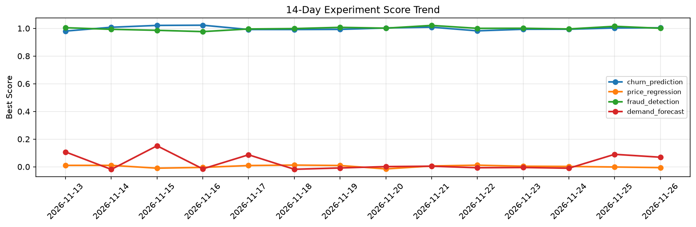

# ML Experiments Report — 2026-11-26

**Run ID:** `8c76e98a72` | **Experiments:** 4 | **Trials:** 13

## Delta vs Yesterday

| Experiment | Today | Yesterday | Change |
|-----------|-------|-----------|--------|
| churn_prediction | 1.0039 | 1.0027 | 📈 0.1% |
| price_regression | -0.006 | -0.0016 | 📉 -275.0% |
| fraud_detection | 1.0006 | 1.0147 | 📉 -1.4% |
| demand_forecast | 0.0691 | 0.09 | 📉 -23.2% |

## churn_prediction (AUC)

**Best Score:** 1.0039 (Trial 1)

| Trial | Score | Overfit Gap | Time | LR | Trees | Leaves |
|-------|-------|-------------|------|-----|-------|--------|
| 1 ⭐ | 1.0039 | 0.012 | 109.2s | 0.2 | 500 | 31 |
| 2 | 0.6141 | 0.0551 | 290.9s | 0.01 | 1000 | 63 |
| 3 | 0.598 | 0.0502 | 45.55s | 0.01 | 200 | 31 |

## price_regression (RMSE)

**Best Score:** -0.006 (Trial 1)

| Trial | Score | Overfit Gap | Time | LR | Trees | Leaves |
|-------|-------|-------------|------|-----|-------|--------|
| 1 ⭐ | -0.006 | 0.0073 | 24.56s | 0.2 | 200 | 63 |
| 2 | 0.4565 | 0.0337 | 114.9s | 0.01 | 500 | 63 |
| 3 | -0.0056 | 0.0059 | 5.19s | 0.2 | 100 | 63 |

## fraud_detection (AUC)

**Best Score:** 1.0006 (Trial 1)

| Trial | Score | Overfit Gap | Time | LR | Trees | Leaves |
|-------|-------|-------------|------|-----|-------|--------|
| 1 ⭐ | 1.0006 | 0.0039 | 126.77s | 0.1 | 1000 | 15 |
| 2 | 0.7614 | 0.0304 | 278.49s | 0.01 | 1000 | 127 |
| 3 | 0.9839 | 0.0094 | 14.95s | 0.1 | 500 | 63 |

## demand_forecast (MAE)

**Best Score:** 0.0691 (Trial 2)

| Trial | Score | Overfit Gap | Time | LR | Trees | Leaves |
|-------|-------|-------------|------|-----|-------|--------|
| 1 | 0.6525 | 0.0269 | 34.2s | 0.01 | 200 | 31 |
| 2 ⭐ | 0.0691 | 0.0209 | 20.38s | 0.05 | 200 | 127 |
| 3 | 0.0802 | 0.0151 | 76.78s | 0.05 | 500 | 127 |
| 4 | 0.0723 | 0.004 | 57.67s | 0.05 | 500 | 15 |
