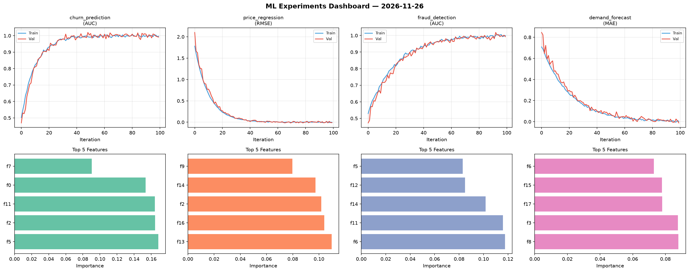

# ML Experiments Report — 2026-11-26

**Run ID:** `2ae8611ea7` | **Experiments:** 4 | **Trials:** 21

## Delta vs Yesterday

| Experiment | Today | Yesterday | Change |
|-----------|-------|-----------|--------|
| churn_prediction | 0.991 | 1.0027 | 📉 -1.2% |
| price_regression | -0.0099 | -0.0016 | 📉 -518.8% |
| fraud_detection | 0.9928 | 1.0147 | 📉 -2.2% |
| demand_forecast | -0.0121 | 0.09 | 📉 -113.4% |

## churn_prediction (AUC)

**Best Score:** 0.991 (Trial 2)

| Trial | Score | Overfit Gap | Time | LR | Trees | Leaves |
|-------|-------|-------------|------|-----|-------|--------|
| 1 | 0.9718 | 0.005 | 126.9s | 0.05 | 500 | 15 |
| 2 ⭐ | 0.991 | 0.0056 | 22.19s | 0.2 | 1000 | 31 |
| 3 | 0.9844 | 0.0192 | 149.18s | 0.2 | 1000 | 63 |
| 4 | 0.9547 | 0.0064 | 13.33s | 0.05 | 100 | 15 |
| 5 | 0.9851 | 0.0207 | 133.64s | 0.1 | 1000 | 127 |
| 6 | 0.9685 | 0.001 | 12.27s | 0.05 | 100 | 127 |

## price_regression (RMSE)

**Best Score:** -0.0099 (Trial 4)

| Trial | Score | Overfit Gap | Time | LR | Trees | Leaves |
|-------|-------|-------------|------|-----|-------|--------|
| 1 | 0.0139 | 0.0112 | 16.96s | 0.2 | 100 | 63 |
| 2 | 0.0491 | 0.0014 | 39.12s | 0.05 | 500 | 15 |
| 3 | 0.5641 | 0.0485 | 23.17s | 0.01 | 500 | 127 |
| 4 ⭐ | -0.0099 | 0.0071 | 120.45s | 0.2 | 1000 | 31 |

## fraud_detection (AUC)

**Best Score:** 0.9928 (Trial 5)

| Trial | Score | Overfit Gap | Time | LR | Trees | Leaves |
|-------|-------|-------------|------|-----|-------|--------|
| 1 | 0.7264 | 0.0465 | 277.15s | 0.01 | 1000 | 127 |
| 2 | 0.6838 | 0.0294 | 10.62s | 0.01 | 100 | 127 |
| 3 | 0.9558 | 0.0104 | 125.2s | 0.05 | 1000 | 127 |
| 4 | 0.989 | 0.0047 | 39.66s | 0.1 | 500 | 15 |
| 5 ⭐ | 0.9928 | 0.0067 | 28.52s | 0.1 | 100 | 15 |

## demand_forecast (MAE)

**Best Score:** -0.0121 (Trial 4)

| Trial | Score | Overfit Gap | Time | LR | Trees | Leaves |
|-------|-------|-------------|------|-----|-------|--------|
| 1 | -0.0061 | 0.0048 | 47.53s | 0.2 | 200 | 127 |
| 2 | -0.0045 | 0.0137 | 155.72s | 0.2 | 1000 | 63 |
| 3 | 1.0599 | 0.0054 | 17.35s | 0.01 | 500 | 31 |
| 4 ⭐ | -0.0121 | 0.0167 | 13.86s | 0.1 | 100 | 15 |
| 5 | 0.3677 | 0.0412 | 71.84s | 0.01 | 1000 | 31 |
| 6 | 0.1641 | 0.0062 | 74.8s | 0.05 | 1000 | 127 |
