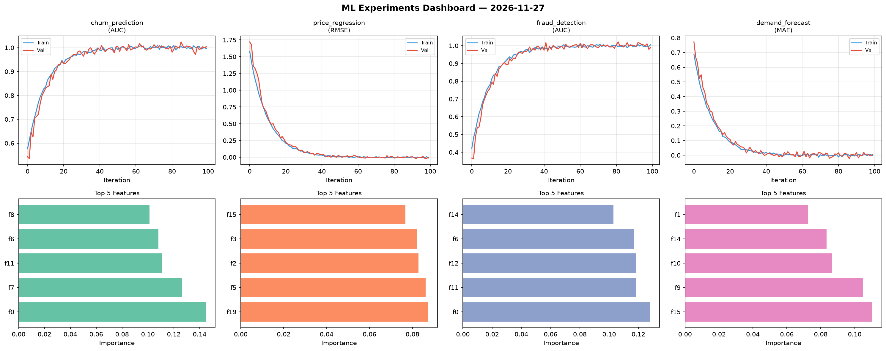
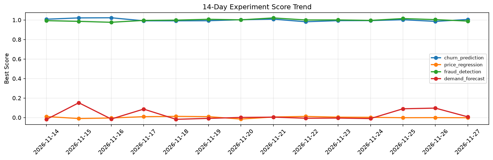

# ML Experiments Report — 2026-11-27

**Run ID:** `561acee1a2` | **Experiments:** 4 | **Trials:** 21

## Delta vs Yesterday

| Experiment | Today | Yesterday | Change |
|-----------|-------|-----------|--------|
| churn_prediction | 1.0053 | 0.9857 | 📈 2.0% |
| price_regression | -0.0017 | -0.0008 | 📉 -90.0% |
| fraud_detection | 0.9889 | 1.0038 | 📉 -1.5% |
| demand_forecast | 0.0073 | 0.0968 | 📉 -92.5% |

## churn_prediction (AUC)

**Best Score:** 1.0053 (Trial 3)

| Trial | Score | Overfit Gap | Time | LR | Trees | Leaves |
|-------|-------|-------------|------|-----|-------|--------|
| 1 | 0.9739 | 0.0135 | 7.4s | 0.1 | 200 | 63 |
| 2 | 0.9731 | 0.0009 | 34.56s | 0.05 | 200 | 15 |
| 3 ⭐ | 1.0053 | 0.0091 | 16.12s | 0.2 | 200 | 15 |
| 4 | 0.9868 | 0.0204 | 149.98s | 0.2 | 1000 | 63 |
| 5 | 0.9482 | 0.0241 | 119.35s | 0.05 | 500 | 63 |
| 6 | 0.9565 | 0.0132 | 6.27s | 0.05 | 100 | 127 |

## price_regression (RMSE)

**Best Score:** -0.0017 (Trial 1)

| Trial | Score | Overfit Gap | Time | LR | Trees | Leaves |
|-------|-------|-------------|------|-----|-------|--------|
| 1 ⭐ | -0.0017 | 0.0085 | 173.3s | 0.2 | 1000 | 31 |
| 2 | -0.0016 | 0.0068 | 30.59s | 0.2 | 200 | 127 |
| 3 | 0.8423 | 0.106 | 2.97s | 0.01 | 100 | 127 |
| 4 | 0.6081 | 0.0631 | 20.74s | 0.01 | 500 | 127 |
| 5 | 0.8823 | 0.1256 | 139.99s | 0.01 | 1000 | 127 |

## fraud_detection (AUC)

**Best Score:** 0.9889 (Trial 1)

| Trial | Score | Overfit Gap | Time | LR | Trees | Leaves |
|-------|-------|-------------|------|-----|-------|--------|
| 1 ⭐ | 0.9889 | 0.0165 | 5.43s | 0.2 | 200 | 127 |
| 2 | 0.6915 | 0.022 | 3.16s | 0.01 | 100 | 63 |
| 3 | 0.941 | 0.0085 | 203.05s | 0.05 | 1000 | 31 |
| 4 | 0.95 | 0.0006 | 113.34s | 0.05 | 500 | 127 |
| 5 | 0.6831 | 0.0145 | 8.43s | 0.01 | 100 | 127 |

## demand_forecast (MAE)

**Best Score:** 0.0073 (Trial 5)

| Trial | Score | Overfit Gap | Time | LR | Trees | Leaves |
|-------|-------|-------------|------|-----|-------|--------|
| 1 | 0.0254 | 0.0223 | 9.56s | 0.1 | 100 | 31 |
| 2 | 0.0331 | 0.0202 | 9.66s | 0.1 | 200 | 15 |
| 3 | 1.413 | 0.207 | 54.77s | 0.01 | 200 | 31 |
| 4 | 0.0149 | 0.0041 | 5.79s | 0.1 | 200 | 31 |
| 5 ⭐ | 0.0073 | 0.0099 | 126.6s | 0.2 | 1000 | 127 |
