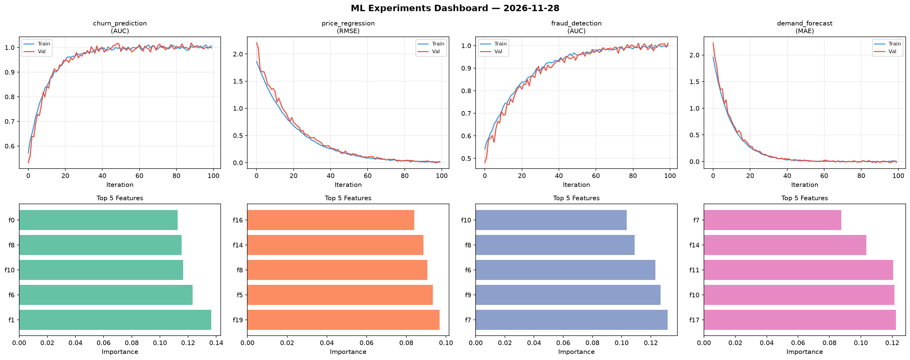
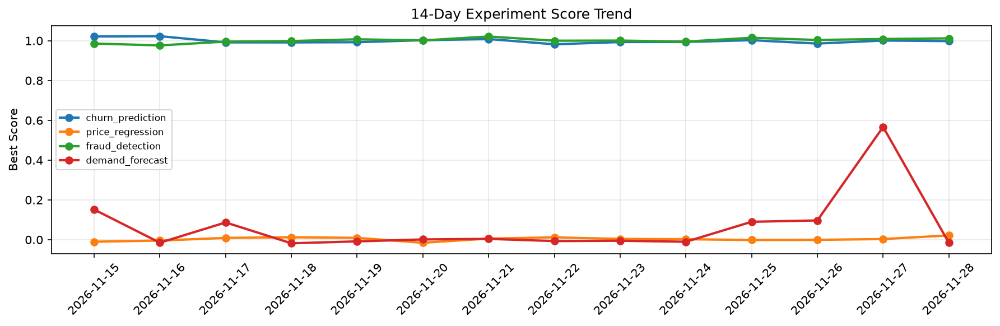

# ML Experiments Report — 2026-11-28

**Run ID:** `245e150227` | **Experiments:** 4 | **Trials:** 15

## Delta vs Yesterday

| Experiment | Today | Yesterday | Change |
|-----------|-------|-----------|--------|
| churn_prediction | 0.9981 | 1.0009 | 📉 -0.3% |
| price_regression | 0.0214 | 0.0033 | 📈 548.5% |
| fraud_detection | 1.0118 | 1.0088 | 📈 0.3% |
| demand_forecast | -0.0157 | 0.5667 | 📉 -102.8% |

## churn_prediction (AUC)

**Best Score:** 0.9981 (Trial 3)

| Trial | Score | Overfit Gap | Time | LR | Trees | Leaves |
|-------|-------|-------------|------|-----|-------|--------|
| 1 | 0.979 | 0.0147 | 51.08s | 0.2 | 500 | 127 |
| 2 | 0.9827 | 0.0124 | 10.32s | 0.2 | 1000 | 15 |
| 3 ⭐ | 0.9981 | 0.0083 | 15.98s | 0.2 | 200 | 63 |

## price_regression (RMSE)

**Best Score:** 0.0214 (Trial 1)

| Trial | Score | Overfit Gap | Time | LR | Trees | Leaves |
|-------|-------|-------------|------|-----|-------|--------|
| 1 ⭐ | 0.0214 | 0.0086 | 25.49s | 0.1 | 100 | 127 |
| 2 | 0.0704 | 0.002 | 11.39s | 0.05 | 100 | 31 |
| 3 | 1.1979 | 0.0737 | 25.48s | 0.01 | 1000 | 127 |
| 4 | 0.0833 | 0.0058 | 55.46s | 0.05 | 500 | 127 |

## fraud_detection (AUC)

**Best Score:** 1.0118 (Trial 3)

| Trial | Score | Overfit Gap | Time | LR | Trees | Leaves |
|-------|-------|-------------|------|-----|-------|--------|
| 1 | 1.0074 | 0.0002 | 122.67s | 0.2 | 500 | 63 |
| 2 | 0.9971 | 0.0017 | 34.96s | 0.2 | 200 | 127 |
| 3 ⭐ | 1.0118 | 0.012 | 215.48s | 0.1 | 1000 | 31 |
| 4 | 0.9876 | 0.012 | 55.04s | 0.1 | 500 | 15 |
| 5 | 0.9608 | 0.0099 | 26.58s | 0.05 | 500 | 63 |

## demand_forecast (MAE)

**Best Score:** -0.0157 (Trial 3)

| Trial | Score | Overfit Gap | Time | LR | Trees | Leaves |
|-------|-------|-------------|------|-----|-------|--------|
| 1 | 0.0007 | 0.0052 | 26.4s | 0.1 | 100 | 15 |
| 2 | 0.0026 | 0.0007 | 112.59s | 0.2 | 500 | 127 |
| 3 ⭐ | -0.0157 | 0.02 | 14.01s | 0.2 | 500 | 63 |
